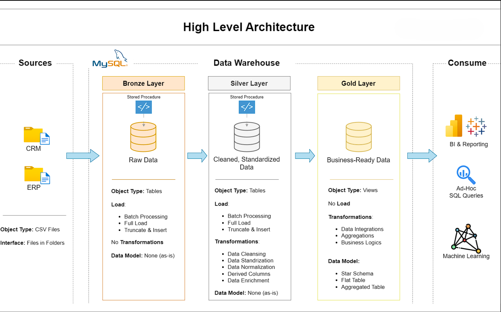
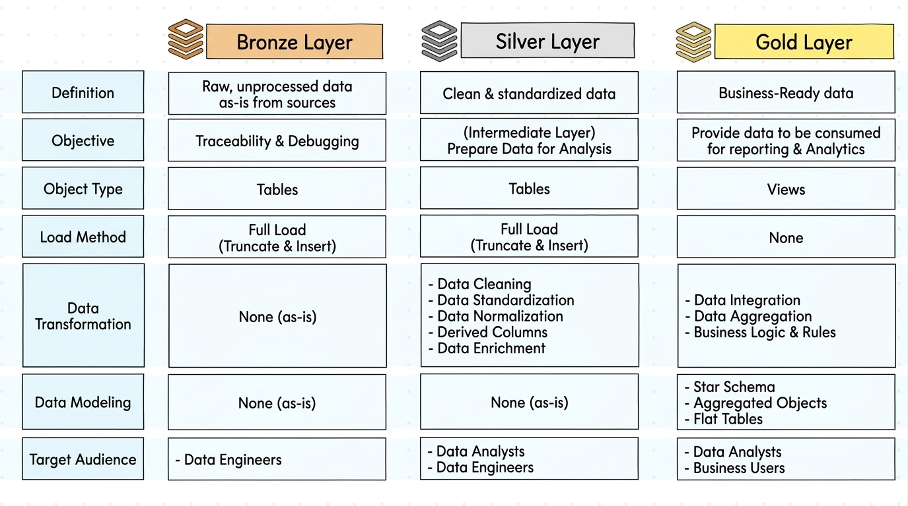

# Data Warehouse and Analytics Project

I take raw files from two systems, a CRM and an ERP, and build one data warehouse in SQL Server. At the end, the data is clean and ready for analysis.

```
sql-data-warehouse-project/
├── 01_datasets/            the six source files the project loads
│   ├── source_crm/         three files from the CRM system
│   └── source_erp/         three files from the ERP system
├── 02_docs/                the requirements, the diagrams and the notes
├── 03_scripts/             the project scripts, in the order of the videos
│   ├── bronze/             loads the raw files
│   ├── silver/             cleans and prepares the data
│   └── gold/               builds the tables for analysis
```

---
## 🏗️ Data Architecture

The data architecture for this project follows Medallion Architecture **Bronze**, **Silver**, and **Gold** layers:



1. **Bronze Layer**: Stores raw data as-is from the source systems. Data is ingested from CSV Files into SQL Server Database.
2. **Silver Layer**: This layer includes data cleansing, standardization, and normalization processes to prepare data for analysis.
3. **Gold Layer**: Houses business-ready data modeled into a star schema required for reporting and analytics.



This project follows the Medallion Architecture, which organizes data into three layers: Bronze, Silver, and Gold. Each layer progressively transforms raw data into business-ready information.

1. Bronze Layer – Raw Data

   - Extracts data directly from source systems.

   - Stores raw data without transformations.

   - Uses Full Load (Truncate & Insert).

   - Maintains data traceability and debugging.

2. Silver Layer – Data Transformation

   - Cleans missing, duplicate, and inconsistent data.

   - Standardizes formats and data types.

   - Creates derived columns and enriches datasets.

   - Loads cleaned data into Silver tables.

4. Gold Layer – Business-Ready Data

   - Integrates data from multiple tables.

   - Applies business logic and aggregations.

   - Implements Star Schema data modeling.

   - Provides views for reporting and analytics.
     
---
## 📖 Project Overview

In this project, I have learned 

1. **Design the architecture:** a modern data warehouse with three layers: bronze, silver and gold.
2. **Build the ETL pipelines:** load the source files and move the data through the layers.
3. **Model the data:** facts and dimensions, ready for reports.
4. **Analyze it:** answer business questions with SQL.

### 🎯 Objective
Develop a modern data warehouse using SQL Server to consolidate sales data, enabling analytical reporting and informed decision-making.

### 📊 BI: Analytics & Reporting (Data Analysis)

Develop SQL-based analytics to deliver detailed insights into:
- **Customer Behavior**
- **Product Performance**
- **Sales Trends**

These insights empower stakeholders with key business metrics, enabling strategic decision-making.  

---

## 🛡️ License

[MIT](LICENSE). Use it, change it, share it, with attribution.

## 🌟 About me
Hey, I am Mohammed Abdul Qader
I am an aspiring Data Analyst with a strong interest in Data Warehousing, Business Intelligence, Dashboarding and Data-Driven decision-making. Through my Data Warehouse and Analytics Project, I have developed practical skills in Data Modeling, SQL, data transformation, and analytical reporting. I am passionate about learning new technologies and transforming raw data into meaningful business insights.
